# Handwritten Digit Recognizer

**A complete CNN-powered recognition system for handwritten digits and short numbers — built, tested, and deployed as a TechCrush Cohort 8 AI/ML capstone.**

Developed by a **six-member TechCrush Cohort 8 AI/ML team**, this project takes handwritten-digit classification from the MNIST dataset to an interactive application. It offers **single-digit prediction** and **multi-digit recognition (2–5 separated digits)** from drawings and real photographs. Multi-digit recognition combines classical computer-vision segmentation with the same trained CNN rather than introducing a second classifier.

**[Primary Streamlit application](https://handwritten-digit-recognizer-tc.streamlit.app/)** · **[Multi-digit preview deployment](https://handwritten-digit-multitest.streamlit.app/)** · **[GitHub repository](https://github.com/Ainulhareery/Handwritten-Digit-Recognizer)**

> [!IMPORTANT]
> **Verified benchmark:** the selected CNN achieved **99.57% accuracy on 10,000 held-out MNIST test images** (**9,957 correct**). This is **not** a measured accuracy for real photographs, canvas drawings, or complete multi-digit strings. The latest reported local test suite completed **21/21 tests**. Multi-digit recognition remains labeled **experimental** because connected writing and low-quality photographs can still fail.
>
> **Release status:** the team merged the multi-digit recognition branch into `main` and confirmed the primary Streamlit deployment supports both recognition modes. The separate preview deployment may remain available for testing. Multi-digit accuracy on unconstrained real-world handwriting has not been measured.

## A real demonstration

The image below is an **actual screenshot** of the Streamlit multi-digit mode recognizing a five-digit canvas drawing. No synthetic handwriting or invented prediction result is used in this README.

<p align="center">
  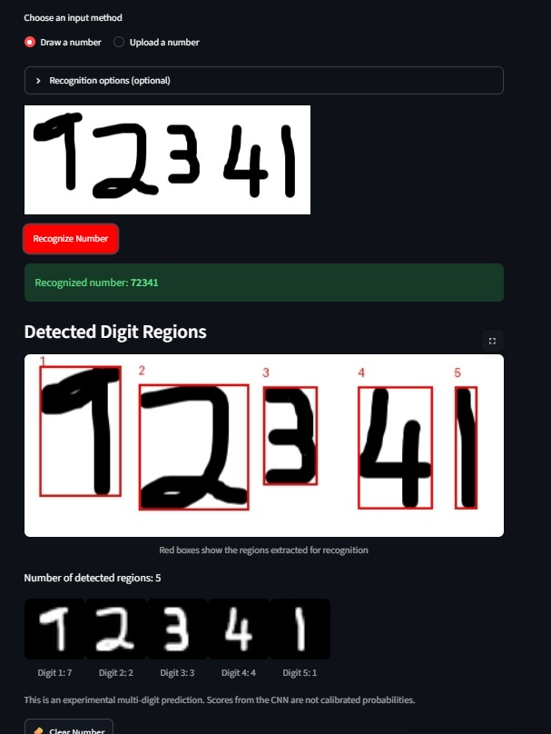
</p>

**Observed in that test:** five regions detected, predicted sequence `72341`, five red boxes aligned to the handwritten characters. This is one successful manual test—not a general accuracy estimate.

## Contents

- [The problem and our approach](#the-problem-and-our-approach)
- [What the application can do](#what-the-application-can-do)
- [How recognition works](#how-recognition-works)
- [Algorithms used](#algorithms-used)
- [Training and model evaluation](#training-and-model-evaluation)
- [Real photographs and application results](#real-photographs-and-application-results)
- [Failures we encountered](#failures-we-encountered)
- [Run the project](#run-the-project)
- [Project structure](#project-structure)
- [Testing](#testing)
- [Technical limitations](#technical-limitations)
- [Evidence provenance and reproducibility](#evidence-provenance-and-reproducibility)
- [Team and project status](#team-and-project-status)

## The problem and our approach

A digit that is obvious to a person can be difficult for software to read. The shape of a handwritten `4` changes from writer to writer; a `9` can look like a `7`; notebook ruling competes with pen strokes; and a photographed number may be rotated, dim, or blurred. Recognizing **several digits in one image** adds another problem: the software must determine **where one digit ends and the next begins** before asking the CNN to classify anything.

We therefore developed the system in two stages:

1. **Single-digit recognition:** inspect and prepare MNIST, train a baseline CNN, improve the architecture, evaluate on held-out data, export the selected model, and serve drawing/image-upload predictions.
2. **Multi-digit recognition:** segment short handwritten numbers into individual regions, prepare each region as a **28 × 28 × 1** input, reuse the **same trained CNN**, and reconstruct the number from left to right.

The extension is not a new model trained on multi-digit strings; it is a **segmentation + individual-digit classification pipeline**. This design works for many separated characters but has known limits with touching or cursive handwriting.

## What the application can do

| Capability | Single-digit mode | Multi-digit mode |
|---|:---:|:---:|
| Draw with mouse or touchscreen | Yes | Yes |
| Upload handwritten-digit photographs | Yes | Yes |
| Correct camera orientation / rotate uploads | Yes | Yes |
| Inspect a processed 28 × 28 digit image | Yes | Yes, per digit |
| View model prediction | Yes | Yes, combined as text |
| Detect multiple handwritten regions | — | Yes, **2–5 separated digits** |
| Visualize detected bounding boxes | — | Yes |
| Manually specify expected digit count | — | Yes, optional |
| Try enhancement for faint/blurred uploads | — | Experimental, optional |
| Handle arbitrary connected cursive numbers | Not applicable | **Not reliably supported** |

The predicted number is stored as **text**, not an integer. This preserves leading zeros in inputs such as `007` when all digits are recognized correctly.

### How recognition works

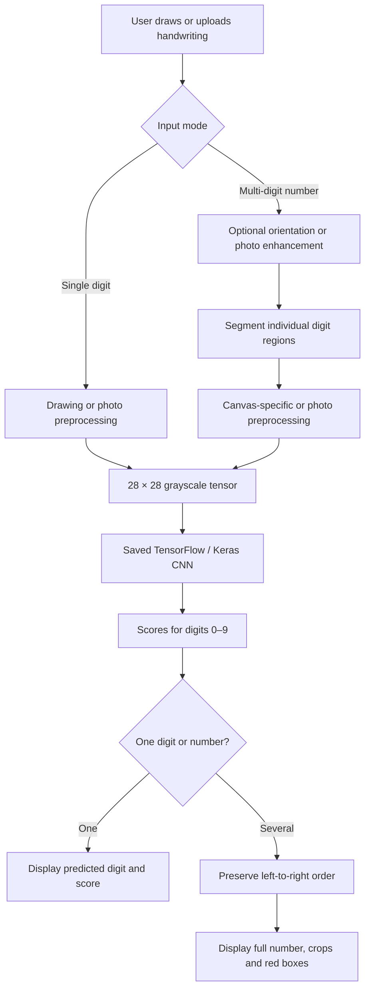

**Notable implementation decisions:**

- **`src/preprocessing.py`** handles photographed single digits: image polarity, background estimation, connected-component selection, crop, resize, and normalization.
- **`preprocess_drawing()` in `app/app.py`** prepares an isolated canvas drawing: invert black strokes to bright pixels, crop, resize into a **20 × 20** area, then center in a **28 × 28** black image.
- **`src/segmentation.py`** detects digit regions in a multi-digit image and returns their positions and crops. The experimental approach includes handling for blue ink and ruled notebook paper.
- **`src/multi_digit.py`** runs the existing `predict_digit()` on each segment. For the multi-digit canvas, `preprocess_canvas_segment()` is used to preserve canvas strokes rather than applying the photographed-digit preprocessing again.
- **`src/visualization.py`** draws bounding boxes using the original-image coordinate system. This corrected an earlier UI issue where rectangles were displayed away from the handwriting.
- **`src/image_quality.py`** offers optional photo enhancement, not a guaranteed deblurring or restoration algorithm.

The system runs the **saved model** during inference; opening the web app does not retrain the network.

## Algorithms used

This project combines **supervised deep-learning classification** with **classical computer-vision segmentation**. They solve different parts of the recognition task.

| Component | Algorithm / method actually used | Role in the system |
|---|---|---|
| Digit classification | **Convolutional Neural Network (CNN)** implemented with TensorFlow/Keras | Learns visual patterns and assigns scores to classes `0`–`9` |
| CNN training | **Supervised learning** with the **Adam optimizer**, **sparse categorical cross-entropy loss**, ReLU activations and a ten-class softmax output | Trains the model on labeled MNIST examples |
| Clean canvas segmentation | **Grayscale thresholding + connected-component analysis** (`cv2.connectedComponentsWithStats`), with heuristic grouping of strokes | Locates individual black handwritten characters on a white drawing canvas |
| Blue-ink notebook photographs | **Colour-channel difference thresholds** (blue relative to red/green), **morphological opening** to remove long notebook lines, and connected components | Separates blue handwritten strokes from ruled paper |
| General-photo fallback | **Gaussian background estimation, contrast thresholding, morphological line removal, connected components, and vertical ink-profile cuts** | Attempts digit separation when the canvas or blue-ink path is unsuitable |
| Optional expected count | **Heuristic vertical ink-projection splitting** where a plausible low-ink gap exists | Attempts to recover a requested number of digit regions; it does **not** provide the correct digit labels |
| Optional weak-photo enhancement | **CLAHE local contrast enhancement** in LAB colour space, followed by mild sharpening | Improves some low-contrast uploads before segmentation; it cannot reliably reverse severe blur |
| Final multi-digit result | **Left-to-right segmentation + repeated CNN inference + string concatenation** | Combines individual predictions while preserving leading zeros |

**The central learning algorithm is the CNN**, not OpenCV. OpenCV implements *rules-based image processing* to find individual digit regions; the saved CNN predicts the identity of each region. We did **not** use YOLO, a transformer, a CRNN/CTC sequence model, or a separately trained multi-digit classifier.

For a complete number, successful prediction depends on **both** correct segmentation and correct CNN classification. Errors in either stage can change the final result. The implementation is in `src/segmentation.py`, `src/multi_digit.py`, `src/preprocessing.py`, `src/image_quality.py`, and `src/inference.py`.

## Training and model evaluation

### Data preparation

Training used **[MNIST](https://www.tensorflow.org/datasets/catalog/mnist)**, loaded through `tf.keras.datasets.mnist.load_data()`. Each sample is a labeled grayscale handwritten digit, originally **28 × 28 pixels**.

| Dataset partition | Images | How it was used |
|---|---:|---|
| Training | 54,000 | Model weight updates |
| Validation | 6,000 | Model selection, early stopping and scheduling |
| Held-out test | 10,000 | Final evaluation |
| **Total** | **70,000** | **10 digit classes: 0–9** |

The original 60,000-image training portion was divided into a stratified **54,000/6,000** train/validation split using seed **42**. Images were cast to `float32`, normalized from `[0, 255]` to `[0, 1]`, and reshaped to `(28, 28, 1)`.

**Important reproducibility detail:** The training notebook examined image shapes, pixel distributions, class balance and data consistency. No verified training-time augmentation was used; do not describe photo rotation or optional Streamlit enhancement as augmentation during model training.

### CNN comparison

Two CNN architectures were evaluated in Google Colab:

| Measurement | Baseline CNN | Selected improved CNN |
|---|---:|---:|
| Parameters | 34,826 | **97,130** |
| MNIST test accuracy | 98.67% | **99.57%** |
| MNIST test loss | 0.035964 | **0.014767** |
| Correct / 10,000 | 9,867 | **9,957** |
| Incorrect / 10,000 | 133 | **43** |

<p align="center">
  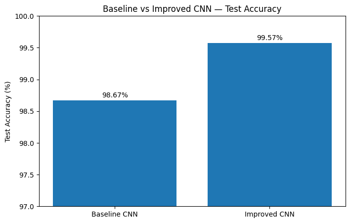
</p>

*Chart exported from the actual project training notebook—not an illustrative replacement.*

The selected architecture used **two convolutional blocks**, each with pairs of convolution layers, batch normalization, ReLU activations, max-pooling and dropout, followed by a ten-class softmax output. Training used Adam (`learning_rate=0.001` initially), `sparse_categorical_crossentropy`, batch size **128**, early stopping and learning-rate reduction on validation loss. The improved run completed **14 epochs** (best validation-loss epoch: **11**), with best weights restored.

<p align="center">
  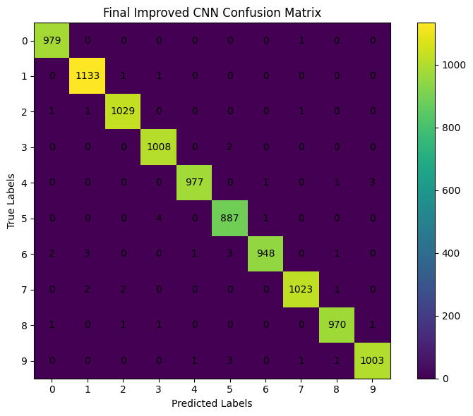
</p>

The selected saved model is expected at **`models/final_digit_model.keras`**. The notebook also checked that the exported model could be reloaded and produce matching predictions on a sample batch.

> **Interpretation:** Accuracy, loss and the confusion matrix above refer to **MNIST test images**. A softmax value shown in the interface is a model score; it is **not** a calibrated probability or a promise that a prediction is correct.

## Real photographs and application results

These examples were **handwritten and photographed on real paper**, then submitted to the experimental Streamlit app. The source photos and app screenshots are included in `docs/images/`.

### Case study 1 — `9254` on dark ruled paper

| Original photographed handwriting | Actual Streamlit recognition |
|:---:|:---:|
| 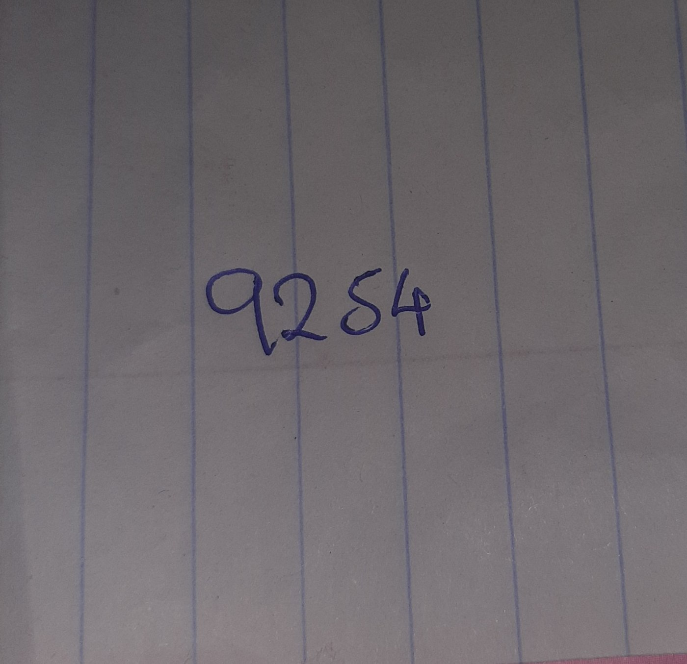 | 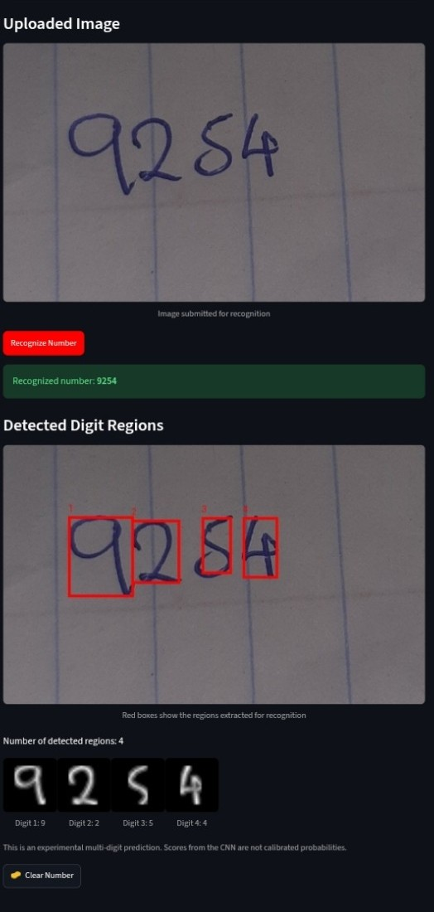 |

**Observed result:** `9254 → 9254`, with four digit regions detected. This case originally failed segmentation; a colour-aware ink-detection improvement was developed and tested using the original photo.

### Case study 2 — `347` with a distinctive handwritten `3`

| Original photographed handwriting | Actual Streamlit recognition |
|:---:|:---:|
| 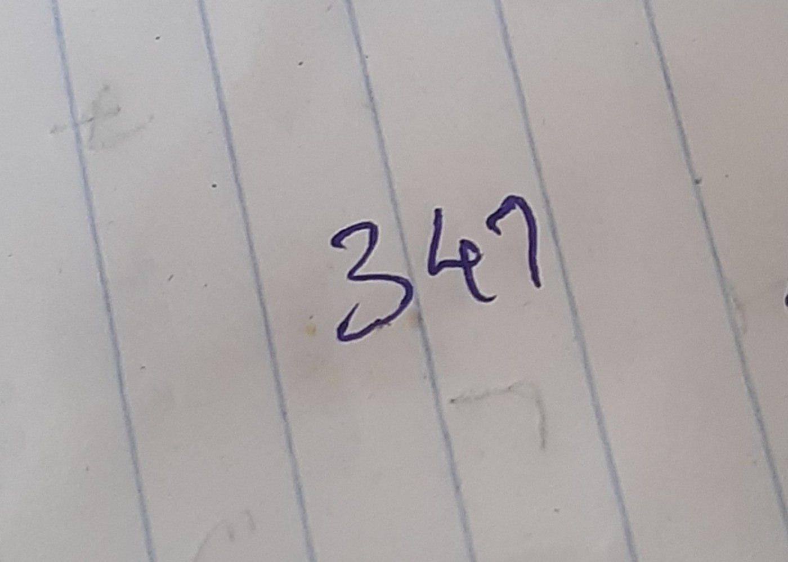 | 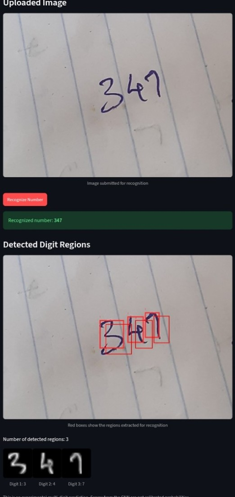 |

**Observed result:** `347 → 347`, with three detected regions. An earlier version recognized this as `747` because the first digit was not extracted intact. After revising segmentation, the application extracted and classified the three characters successfully in the shown retest.

### Case study 3 — More real phone-camera trials

The following captures are from additional **real handwritten-paper uploads**. They include the photographs, red detection regions and individual digit previews shown by the deployed app. None are synthetic example outputs.

| `912 → 912` | `268 → 268` | `543 → 543` |
|:---:|:---:|:---:|
| 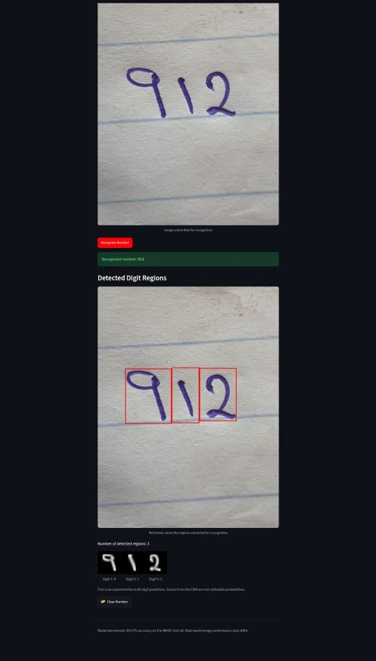 | 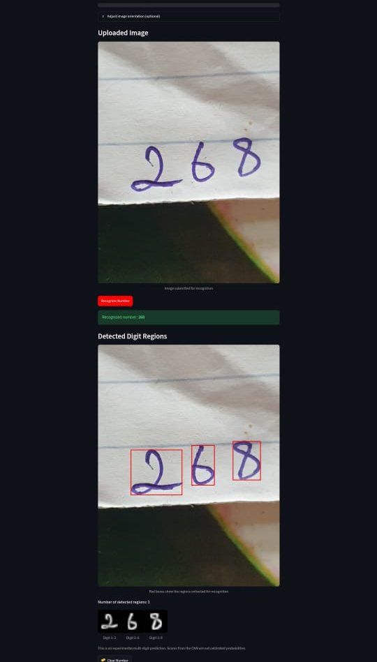 | 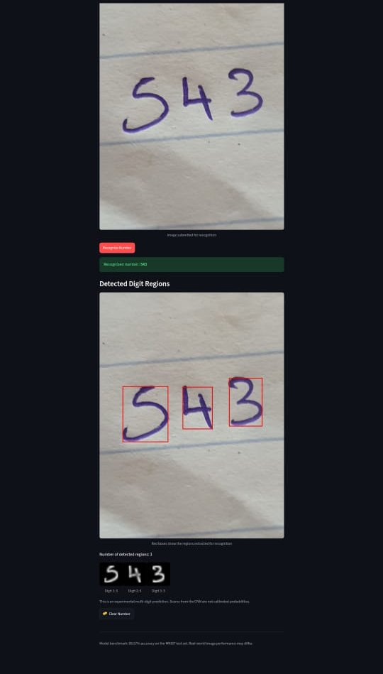 |

Each illustrates **one** successful photographed-paper test; the screenshots do not establish population-level real-world accuracy.

### Case study 4 — Five digits on the drawing canvas

The canvas test `72341 → 72341` is shown [at the top of this README](#a-real-demonstration). All five character regions were visible and labeled in the original screenshot.

The three photographed-paper trials above were also observed to succeed. Two later **user-reported** retests recognized `14865` (with expected count set to **5**) and `4234` (Automatic mode). Those later two outcomes were reported in conversation; separate screenshots of those exact successful retests are **not** included in this evidence folder.

### What our manual trials do and do not establish

These demonstrations show that the prototype can work on several real drawings and photographs. They **do not** measure full-number accuracy over a representative dataset. There was no independently validated, held-out real-photo benchmark comparable to the MNIST test set.

## Failures we encountered

We retained examples of mistakes because they were important to the engineering process.

### A high-scoring wrong prediction

| Correctly recognized single `7` | Misclassified handwritten `4` |
|:---:|:---:|
| 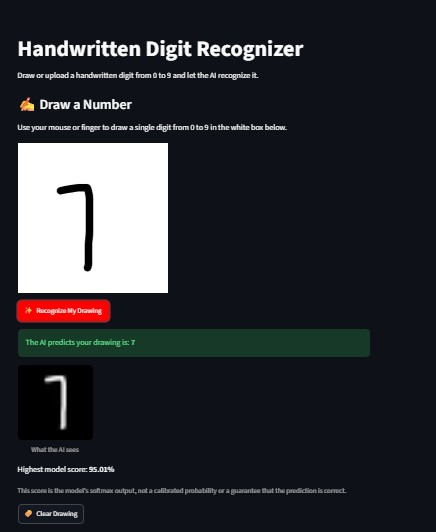 | 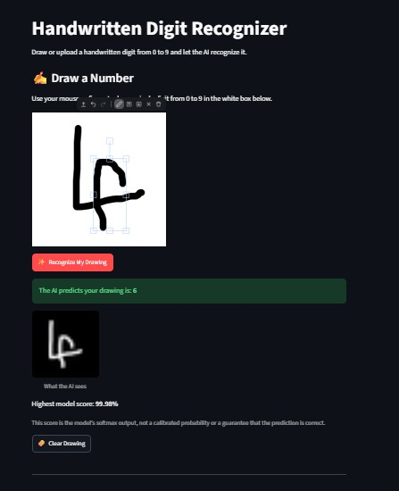 |

A handwritten `4` was once predicted as **`6`** with a **99.98% softmax score**. A different `4` was recognized correctly, and two separate `7` examples were also recognized. This demonstrates handwriting-style sensitivity and why a high softmax score should not be treated as certainty.

### Multi-digit canvas misclassification

<p align="center">
  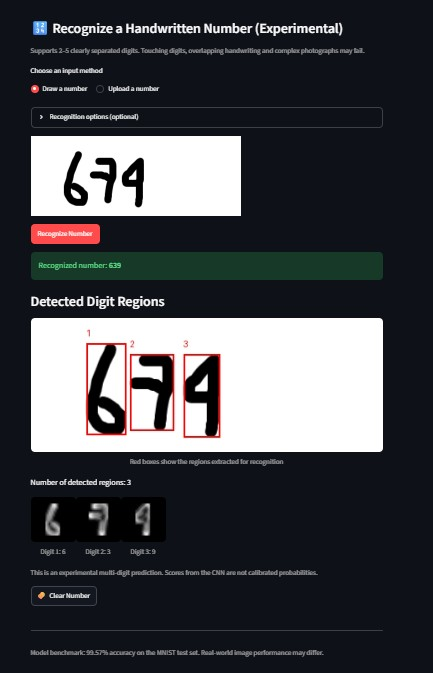
</p>

In this trial, the app found **three** regions for a handwritten `674`, but classified the number as **`639`**. The issue was not simply a missing region: the extracted `7` and `4` were misclassified. This motivated a more consistent **canvas-specific preprocessing path**.

Other observed limitations included:

- A photographic `962` being predicted as **`961`**, despite extracting three regions.
- Blurry notebook handwriting sometimes producing **no usable regions** or multiple false regions.
- An earlier cursive `2004` example being reduced to **`204`** because adjacent digits were grouped together.
- Some canvas drawings with touching or unusually thick strokes being merged or split incorrectly.

> [!NOTE]
> Results above occurred at specific development stages and do **not** imply every failure remains reproducible in the latest experimental build. Conversely, individual later successes do not prove the underlying failure class has been solved generally.

## Run the project

### Requirements

- **Python 3.12** is the recommended runtime for reproducing the observed Streamlit deployment environment.
- Packages installed from the repository's **`requirements.txt`** (including TensorFlow/Keras, Streamlit, Pillow, NumPy, pandas and OpenCV for multi-digit processing).
- The saved CNN at **`models/final_digit_model.keras`**.

The merged `main` branch contains **both recognition modes**. To run the combined application locally:

```bash
git clone https://github.com/Ainulhareery/Handwritten-Digit-Recognizer.git
cd Handwritten-Digit-Recognizer
python -m venv .venv
```

Activate the environment: **Windows Git Bash** — `source .venv/Scripts/activate`; **macOS/Linux** — `source .venv/bin/activate`. Then install and launch:

```bash
python -m pip install -r requirements.txt
python -m streamlit run app/app.py
```

Open the local URL shown by Streamlit, typically `http://localhost:8501`.

**Run the project from `main`; no feature-branch checkout is required.** The team has confirmed the primary Streamlit application works with the merged recognition features.

**Windows note:** A previous Windows Python 3.14 environment was blocked from loading a native TensorFlow DLL by application-control policy. This is an environment limitation, not evidence that the model failed. Use a supported Python environment or the deployed Streamlit Cloud application; do not weaken operating-system security controls to force a local run.

### Single-digit recognition

1. Draw one digit in the white canvas and select **Recognize My Drawing**, **or** upload a PNG/JPG photo containing one digit.
2. For uploads, correct orientation using the rotation selector if necessary.
3. Compare the input and the 28 × 28 processed image, and examine the prediction and scores.
4. Use **Clear Drawing** when starting another drawing.

### Multi-digit recognition (experimental)

1. Select **Draw a number** or **Upload a number** in the experimental section.
2. Write or upload **2–5 separated handwritten digits**.
3. If automatic segmentation merges or misses digits, open **Recognition options (optional)** and select the expected count (2–5). This provides a *count*, not the correct answer.
4. For a faint uploaded photograph, optionally try the **experimental enhancement** control. Compare with enhancement disabled; it is not guaranteed to help.
5. Select **Recognize Number** and examine the full prediction, detected boxes, count and per-digit 28 × 28 previews.

For uploaded photos, start with readable handwriting, reasonable lighting and a crop around the writing. If strokes are very blurred or characters overlap, the system may not be able to separate them reliably.

## Project structure

The following tree shows the **relevant application structure and the documentation assets supplied with this README**. It is not a claim that every additional file in the repository is shown.

```text
Handwritten-Digit-Recognizer/
├── README.md
├── requirements.txt
├── app/
│   └── app.py                      # Streamlit UI, drawing handlers and recognition options
├── models/
│   └── final_digit_model.keras    # Saved selected CNN; required for inference
├── src/
│   ├── inference.py                # Load model and predict digits 0–9
│   ├── preprocessing.py            # Single-digit photo preprocessing
│   ├── segmentation.py             # Experimental multi-digit region detection
│   ├── multi_digit.py              # Per-digit CNN inference and result assembly
│   ├── image_quality.py            # Optional weak-photo enhancement
│   └── visualization.py            # Bounding boxes in original-image coordinates
├── tests/
│   ├── test_multi_digit.py
│   ├── test_segmentation_regression.py
│   ├── test_new_photo_regression.py
│   ├── test_v5_features.py
│   └── fixtures/                   # Segmentation regression inputs
└── docs/
    ├── EVIDENCE.md                 # Image origins and evidence notes
    └── images/
        ├── photos/                 # Actual camera photos of handwritten digits
        ├── screenshots/            # Actual Streamlit application captures
        └── experiments/            # Figures extracted from the Colab notebook
```

**Training notebook:** The experiments were performed in the project's Google Colab notebook, supplied during development as `HWDR (3).ipynb`. Its current tracked location in the public repository has **not been confirmed**, so no notebook link has been invented here. If a clean notebook is committed later, link its actual path from this section.

## Testing

The final locally reported run on **15 October 2026** was:

```text
Ran 21 tests in 3.118s

OK
```

The suite covered:

- Empty, invalid and single-digit-only segmentation inputs.
- Separated dark/light digit images and a mocked multi-digit classifier.
- Real notebook-photo regression cases, including `347`, `962` and difficult ruled-paper inputs.
- Expected-digit-count validation and forwarding.
- Canvas segmentation on three captured drawings, including transparency handling.
- Image enhancement preserving dimensions.
- Detection-box coordinate handling and rejection of invalid boxes.

To rerun the existing tests:

```bash
python -m unittest discover -s tests -p "test_*.py" -v
```

**Keep `tests/` and `tests/fixtures/` in the repository.** These files guard against regressions when segmentation, preprocessing or the interface is changed. They are not loaded by the deployed prediction pipeline and do not need to be copied into the app UI. Only exclude a fixture from a public repository if it contains private or unapproved material; replace it with a consented or synthetic test fixture rather than silently removing the test.

The test suite primarily checks **segmentation, integration and display behavior**. It does **not** calculate a statistically representative accuracy for the deployed multi-digit CNN system. Local TensorFlow import restrictions may also differ from the cloud deployment environment.

## Technical limitations

1. **MNIST-to-real-world gap:** The network was evaluated on standardized MNIST images, not a comprehensive set of phone photographs or cursive handwriting.
2. **Segmentation-first design:** The CNN expects a single digit per input. If two characters merge into one crop, the classifier cannot reliably infer that they form two digits.
3. **Handwriting variation:** Detached strokes, thick markers, unusual `4`/`7` shapes and overlapping characters can change classification.
4. **Image quality:** Lighting, paper lines, motion blur and camera focus affect the mask and crop quality; enhancement cannot reconstruct details that were never captured.
5. **Model score limitations:** A high softmax value can accompany an incorrect prediction.
6. **Scale of evaluation:** The documented real-world cases are exploratory manual trials. A separate, labeled, held-out photo/canvas test set would be needed to publish real-world recognition accuracy.

Potential further work includes a documented real-world benchmark, better treatment of touching digits, controlled training-time augmentation, confidence calibration and an OCR sequence model for genuinely connected handwriting. **These are future directions, not features claimed as complete.**

## Evidence provenance and reproducibility

This README intentionally uses **real evidence from the project**:

- Notebook plots were exported from **actual saved cell outputs** of `HWDR (3).ipynb`.
- Notebook-paper images are actual photographs provided during testing.
- Streamlit images are actual browser captures showing the drawing/photo, model output and diagnostic regions.
- Screenshots were **cropped to remove unrelated phone/browser interface areas**; predictions and bounding-box content were not redrawn or replaced.
- Camera photos were resized/compressed for GitHub and saved without camera EXIF metadata. The underlying handwritten content was not modified.

See **[`docs/EVIDENCE.md`](docs/EVIDENCE.md)** for the precise source filename, expected test value and purpose of each image.

Some images also serve as local `tests/fixtures/` regression inputs; the documentation copies are intended for human readers and are **not** automatically loaded by the running recognizer. The app does **not** have special code to return the numbers shown in README screenshots.

## Team and project status

**TechCrush Cohort 8 · AI/Machine Learning capstone · Six-person development team.** The team built the dataset/model workflow, evaluated the CNN, implemented a Streamlit interface, tested real handwriting, and documented observed limitations.

Contributors should be credited from the team's approved submission records and actual work, rather than assigning unverified roles or names in public documentation.

**Final submission scope:** one repository containing the trained single-digit CNN, Streamlit interface, multi-digit segmentation pipeline, diagnostics, optional weak-photo enhancement, automated tests and real evidence images. The multi-digit component is marked experimental because performance on connected/cursive writing remains unmeasured.

**Release verification:** the team merged `feat/multi-digit-recognition` into `main` and confirmed that the primary Streamlit application supports single-digit and multi-digit recognition. Styling experiments can continue on a separate branch without affecting the released application.

For project defense, report **99.57% as MNIST-only accuracy**, and describe the real-world tests as individual demonstrations with documented failures—not an equivalent benchmark.

**License:** No open-source license is asserted here; consult the repository owner and the repository's actual license file before reuse or redistribution.

---

**Built with Python · TensorFlow/Keras · Streamlit · OpenCV · Pillow · NumPy**  
**Training:** Google Colab · **Validation:** MNIST benchmark, automated tests and real handwritten trials
